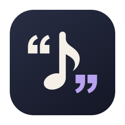
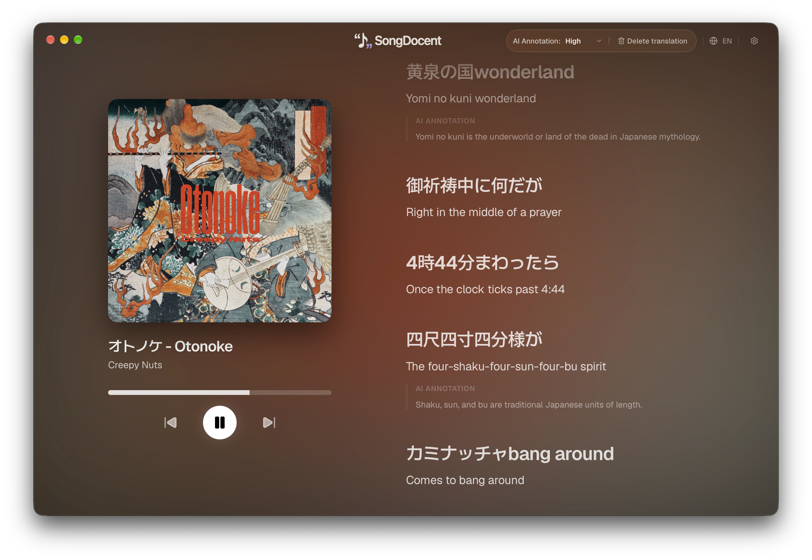
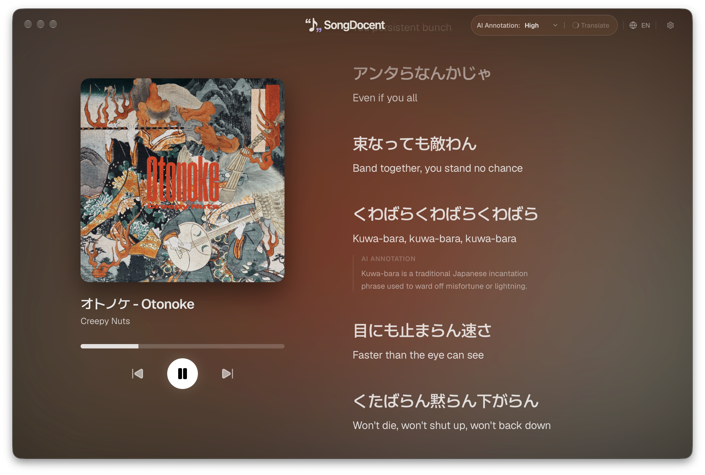
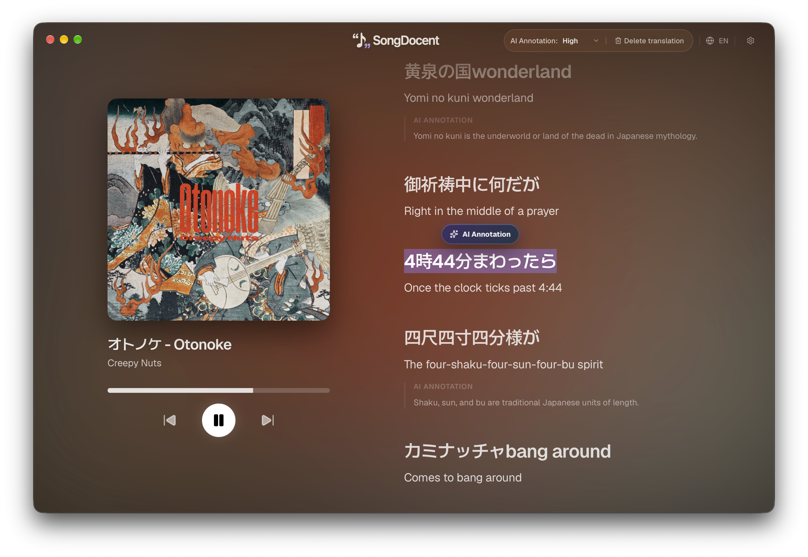
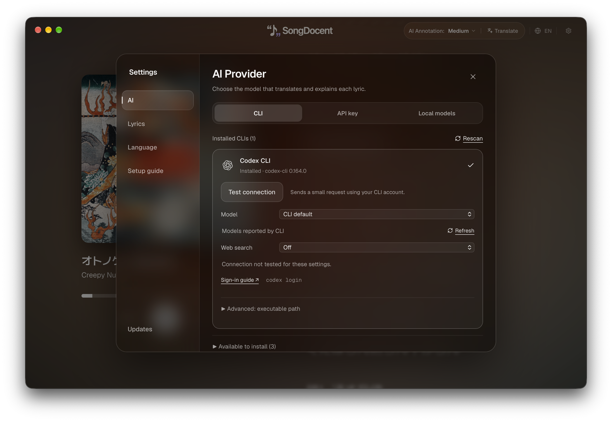

<p align="center">
  <a href="README.ko.md"><kbd>한국어</kbd></a>
  ·
  <a href="README.md"><kbd>English</kbd></a>
  ·
  <a href="README.ja.md"><kbd>日本語</kbd></a>
  ·
  <a href="README.es.md"><kbd>Español</kbd></a>
  ·
  <a href="README.fr.md"><strong><kbd>Français</kbd></strong></a>
  ·
  <a href="README.de.md"><kbd>Deutsch</kbd></a>
  ·
  <a href="README.pt-BR.md"><kbd>Português (Brasil)</kbd></a>
  ·
  <a href="README.zh-CN.md"><kbd>简体中文</kbd></a>
</p>

<p align="center">
  
</p>

<h1 align="center">SongDocent</h1>

<p align="center">
  <strong>Écouter la musique, puis la comprendre.</strong><br />
  Une application de bureau pour lire les paroles du morceau en cours, leur traduction par IA et leur contexte.
</p>

<p align="center">
  <a href="https://github.com/kjsuo/songdocent/actions/workflows/ci.yml"></a>
  <a href="LICENSE"></a>
  <a href="https://github.com/kjsuo/songdocent"></a>
</p>

<p align="center">
  <a href="https://github.com/kjsuo/songdocent/releases">Télécharger</a> ·
  <a href="#getting-started">Premiers pas</a> ·
  <a href="#development">Développement</a> ·
  <a href="https://github.com/kjsuo/songdocent/issues">Signaler un problème</a>
</p>

<p align="center">
  macOS · Windows (Beta) &nbsp;|&nbsp; Tauri 2 · React · Rust &nbsp;|&nbsp; MIT
</p>

---

SongDocent est votre guide musical personnel lorsque vous écoutez Spotify ou Apple Music. Il détecte le morceau en cours et affiche les paroles originales et leur traduction sur un même écran. **AI Annotation** apporte des précisions sur les personnes et les références culturelles que vous ne connaissez pas. Vous pouvez aussi sélectionner un passage pour demander une explication plus détaillée.

La musique se lit dans votre application habituelle Spotify ou Apple Music. SongDocent affiche les paroles selon l'état de lecture et y ajoute des traductions et des explications.

## Vidéo de présentation

https://github.com/user-attachments/assets/f8017c97-470a-4ff9-aa55-8ef45ebfbb02

[Crédits de la vidéo](docs/media/v7-credits.md)

## Captures d'écran

Lisez sur un même écran les paroles originales du morceau en cours dans Spotify ou Apple Music, leur traduction et les annotations d'IA qui expliquent leur contexte culturel.

> [!WARNING]
> L'intégration des paroles de SongDocent utilise des méthodes d'accès non officielles au lieu d'une API officielle. SongDocent n'est un produit officiel ni de Spotify ni d'Apple. Des changements dans les services peuvent interrompre certaines fonctions, et les politiques du fournisseur peuvent entraîner des restrictions ou la suspension de votre compte.



### Le contexte culturel des paroles

Des annotations d'IA apparaissent sous les expressions inconnues pour vous aider à en comprendre le contexte pendant la lecture des paroles.



### Sélectionnez le passage qui vous intéresse

Lorsque vous sélectionnez une partie des paroles à la souris, le bouton **AI Annotation** apparaît. Vous pouvez demander une explication du passage sélectionné.



### Choisissez la connexion à l'IA

Dans **Paramètres → IA**, choisissez une CLI, une clé API ou un modèle local. L'onglet CLI permet de vérifier les outils installés, de configurer le modèle et la recherche web, puis de tester la connexion.



## Fonctions principales

| Fonction | Description |
| --- | --- |
| **Détection du morceau en cours** | Récupère les informations du morceau, la pochette et l'état de lecture des applications de bureau Spotify et Apple Music. |
| **Synchronisation des paroles** | Met en évidence le passage en cours et fait défiler automatiquement les paroles lorsqu'elles disposent de repères temporels. |
| **Traduction des paroles par IA** | Lisez l'original et la traduction côte à côte. Recherchez et sélectionnez la langue de traduction souhaitée. |
| **AI Annotation** | Ajoute de courtes explications sur les noms propres et les références culturelles inconnues dans les paroles. La densité des annotations est également réglable. |
| **Explication d'un passage sélectionné** | Sélectionnez une partie des paroles pour demander une explication des nuances, des jeux de mots et du contexte. |
| **Choix de la connexion à l'IA** | Vous pouvez utiliser une CLI, une clé API ou un LLM local. Consultez le [tableau des options de connexion](#ai-connection-options) ci-dessous pour en savoir plus. |
| **Appui sur la recherche** | Les connexions API et CLI compatibles permettent d'activer la recherche web pour les demandes de traduction ou d'explication. |
| **Cache des traductions** | Recharge les traductions enregistrées en fonction du morceau et de la langue. |
| **Mises à jour dans l'application** | Dans les versions de distribution où les mises à jour sont configurées, vous pouvez rechercher et installer de nouvelles versions depuis les paramètres. |

L'interface est disponible en coréen, anglais, japonais, espagnol, français, allemand, portugais du Brésil et chinois simplifié. **La langue de l'interface et la langue de traduction des paroles se règlent séparément**.

## Télécharger

Consultez les programmes d'installation correspondant à votre système d'exploitation et à votre processeur sur [GitHub Releases](https://github.com/kjsuo/songdocent/releases). Si aucun programme d'installation n'est encore proposé, vous pouvez [exécuter l'application à partir du code source](#development).

| Environnement | Cible de distribution | Format d'installation |
| --- | --- | --- |
| macOS · Apple Silicon | `aarch64-apple-darwin` | `.dmg` |
| macOS · Intel | `x86_64-apple-darwin` | `.dmg` |
| Windows · x64 (Beta) | `x86_64-pc-windows-msvc` | Programme d'installation NSIS `.exe` |

**Windows bêta :** La version Windows n'a pas encore été suffisamment testée. Certaines fonctionnalités peuvent ne pas fonctionner comme prévu. Signalez tout problème rencontré.

La configuration de distribution actuelle utilise une signature ad hoc sur macOS et n'inclut pas la notarisation Apple. Si l'application téléchargée est bloquée, vérifiez sa provenance, puis utilisez **Réglages Système → Confidentialité et sécurité → Ouvrir quand même**. Le programme d'installation Windows ne dispose pas non plus d'une signature de code.

<a id="getting-started"></a>

## Premiers pas

1. **Lancez un morceau dans l'application de bureau Spotify ou Apple Music.**
2. **Ouvrez SongDocent et choisissez la langue de l'application.**
3. **Connectez un fournisseur de paroles.** Choisissez Spotify ou Apple Music et suivez les instructions de connexion de l'application. L'authentification se fait dans une fenêtre de connexion distincte. Si la connexion automatique ne fonctionne pas, suivez les instructions de saisie manuelle des paramètres avancés.
4. **Configurez un fournisseur d'IA.** Dans les paramètres, choisissez une clé API, une CLI ou un modèle local. Pour une CLI, installez l'outil et connectez-vous dans le terminal. Relancez ensuite la détection dans l'application et testez la connexion. Pour une API, saisissez votre propre clé. Pour un modèle local, indiquez l'adresse du serveur Ollama ou LM Studio et le modèle.
5. **Choisissez la langue de traduction et terminez la configuration.** Lorsque le morceau et les paroles apparaissent, lancez **Traduire**. Sélectionnez un passage pour demander une explication.

Les tarifs, les limites d'utilisation et les modèles disponibles des API et CLI dépendent du fournisseur choisi, du mode d'authentification du compte et de l'abonnement. Même avec une CLI, les demandes sont envoyées au service d'IA configuré dans cet outil. La qualité et la vitesse des modèles locaux dépendent du modèle et des caractéristiques de votre ordinateur.

<a id="ai-connection-options"></a>

### Options de connexion à l'IA

| Type de connexion | Outils et fournisseurs pris en charge | Éléments nécessaires |
| --- | --- | --- |
| CLI | Codex CLI, Claude Code, Gemini CLI, Antigravity CLI, OpenCode | Une CLI installée sur l'ordinateur et une connexion au compte ou une authentification du fournisseur configurée dans l'outil |
| Clé API | Gemini, OpenAI, Claude | Votre propre clé API et le modèle à utiliser |
| Clé API | API compatible avec OpenAI | L'URL de base du service, le nom du modèle et une clé API si nécessaire |
| Modèle local | Ollama | Un serveur Ollama en cours d'exécution, le nom du modèle installé et l'adresse du serveur |
| Modèle local | LM Studio | Un serveur LM Studio en cours d'exécution, le modèle chargé et l'adresse du serveur |

### Se connecter avec une CLI

1. Installez la CLI et connectez-vous dans le terminal en suivant sa documentation officielle. Les instructions d'installation et de connexion sont aussi accessibles depuis la liste **CLI disponibles à l'installation** de l'application.
2. Dans **Paramètres → IA → CLI**, cliquez sur **Relancer la détection**, puis choisissez la CLI installée.
3. Choisissez un modèle. L'option **Modèle par défaut de la CLI** utilise le modèle par défaut de l'outil. Vous pouvez saisir manuellement un modèle absent de la liste.
4. Cliquez sur **Tester la connexion**. Le test envoie une demande réelle avec les paramètres choisis et peut consommer le quota de votre compte. Relancez le test après avoir changé le modèle ou les paramètres de recherche web.

Si la CLI n'apparaît pas, indiquez son chemin dans **Avancé : chemin de l'exécutable**, puis relancez la détection. L'installation et la connexion se font dans le terminal. SongDocent exécute la CLI connectée pour demander des traductions et des annotations.

| CLI | Guide d'installation | Guide de connexion |
| --- | --- | --- |
| Codex CLI | [Installation](https://developers.openai.com/codex/cli/) | [Authentification](https://developers.openai.com/codex/auth/) |
| Claude Code | [Installation](https://code.claude.com/docs/en/setup) | [Authentification](https://code.claude.com/docs/en/authentication) |
| Gemini CLI | [Installation](https://geminicli.com/docs/get-started/installation/) | [Authentification](https://geminicli.com/docs/get-started/authentication/) |
| Antigravity CLI | [Installation](https://antigravity.google/docs/cli/install/) | [Authentification](https://antigravity.google/docs/install/) |
| OpenCode | [Installation](https://opencode.ai/docs/) | [Connexion d'un fournisseur](https://opencode.ai/docs/providers/) |

La recherche web est disponible avec les connexions API et CLI qui la prennent en charge. Si vous l'activez dans une CLI, utilisez le test de connexion pour vérifier que la recherche fonctionne et que les sources s'affichent. Les modèles et les fonctions de recherche disponibles dépendent de la version de la CLI et du compte. Un format de réponse inattendu peut faire échouer les demandes de traduction ou d'annotation.

## Données et informations de compte

- **Stockage des identifiants :** Les clés API et les informations de session du service de paroles sont stockées dans macOS Keychain ou Windows Credential Manager.
- **Authentification de la CLI :** Les connexions CLI utilisent les paramètres d'authentification existants de chaque outil. La connexion se fait dans le terminal. Vous n'avez pas besoin de saisir une clé API supplémentaire dans SongDocent. Le traitement des identifiants et de l'historique des demandes de la CLI dépend des paramètres de chaque outil.
- **Connexion au service de paroles :** Utilise les valeurs de session `sp_dc` de Spotify ou `media-user-token` d'Apple Music. Lors de la connexion automatique, Rust vérifie et enregistre ces valeurs. Seul l'état de la connexion est transmis à l'interface.
- **Envoi des demandes :** Les demandes de paroles transmettent les informations de session au service de paroles sélectionné. Lorsque vous lancez une traduction ou une explication, les paroles, les informations du morceau et le contexte nécessaire sont envoyés au fournisseur d'API choisi, au service d'IA configuré dans la CLI ou au serveur que vous avez configuré. La connexion au service de paroles nécessite un accès réseau même si vous choisissez une IA locale.
- **Cache local :** Les traductions sont enregistrées dans des fichiers de cache sur l'appareil. Leur gestion est distincte de celle du stockage des identifiants.
- **Serveurs propres :** SongDocent n'exploite aucun serveur propre qui collecte les cookies de session des services de paroles.

> **L'intégration des paroles est une fonction non officielle.** SongDocent n'est un produit officiel ni de Spotify ni d'Apple, et la connexion aux paroles n'est pas une intégration avec une API officielle. Des changements dans les services peuvent interrompre son fonctionnement. Les politiques du fournisseur peuvent entraîner des restrictions ou la suspension de votre compte. Lisez les indications de l'écran de connexion avant de l'utiliser.

Les traductions et les explications d'IA peuvent contenir des erreurs. Les résultats qui s'appuient sur la recherche ne garantissent pas non plus l'exactitude. La disponibilité des paroles et leur synchronisation varient selon le morceau et le fournisseur.

<a id="development"></a>

## Développement

### Prérequis

- Node.js 22 LTS
- pnpm : utilisez la version indiquée dans `packageManager` du fichier `package.json`
- Rust stable
- **macOS :** Xcode Command Line Tools
- **Windows :** La charge de travail de développement Desktop en C++ de Visual Studio Build Tools, les outils MSVC et WebView2

### Exécuter depuis le code source

```sh
git clone https://github.com/kjsuo/songdocent.git
cd songdocent
pnpm install --frozen-lockfile
pnpm run tauri dev
```

Pour développer uniquement l'interface, utilisez la commande suivante.

```sh
pnpm run dev
```

Le serveur de développement s'ouvre sur `http://127.0.0.1:1420`. Les fonctions Tauri, comme l'intégration aux lecteurs natifs et le stockage des identifiants, doivent être vérifiées dans l'application de bureau.

### Vérification

```sh
pnpm test
pnpm run build
cargo test --locked --manifest-path src-tauri/Cargo.toml --lib
cargo check --locked --manifest-path src-tauri/Cargo.toml
```

Les tests unitaires et de composants et les vérifications de compilation sont distincts de la vérification de la connexion réelle à Spotify ou Apple Music, de l'authentification et des demandes CLI, des autorisations du système d'exploitation et de la lecture native. Avant une distribution publique, vérifiez le parcours réel de connexion et la connexion des CLI prévues sur macOS et Windows avec des comptes de test dédiés.

### Compiler

```sh
pnpm run tauri build
```

La configuration correspondant à l'hôte actuel est sélectionnée automatiquement.

| Plateforme | Intégration native | Configuration du paquet |
| --- | --- | --- |
| macOS | AppleScript/JXA, distributed player events | `src-tauri/tauri.macos.conf.json` |
| Windows | GSMTC/WinRT, media session events | `src-tauri/tauri.windows.conf.json` |

### Structure du projet

```text
src/
  App.tsx                  Écran des paroles, de la traduction et du lecteur
  SettingsModal.tsx        Paramètres d'IA, de paroles et de langue
  ai/                      Types de connexion à l'IA, détection des CLI et tests de connexion
  setup/                   Configuration initiale et instructions de connexion
  platform/                Textes et instructions propres au système d'exploitation
src-tauri/
  src/
    player.rs              Commandes communes du lecteur
    player_macos.rs        Intégration du lecteur sur macOS
    player_windows.rs      Intégration du lecteur sur Windows
    lyrics.rs              Récupération des paroles
    translation.rs         Traduction et explications par IA
    cli_ai/                Détection, exécution et traitement des réponses CLI
    grounding.rs           Appui sur la recherche
    cache.rs               Cache local des traductions
    secrets.rs             Stockage des identifiants du système d'exploitation
    provider_connection.rs Connexion au compte du service de paroles
    app_updates.rs         Mises à jour de l'application
.github/workflows/         Automatisation des vérifications, des programmes d'installation et des versions
```

## Mises à jour

L'application de distribution recherche les mises à jour après son démarrage. Vous pouvez aussi les rechercher, les télécharger, les installer et redémarrer depuis **Paramètres → Mises à jour**. L'installation et le redémarrage attendent la fin des traductions ou des explications en cours. Sur macOS, l'application vous invite à redémarrer après l'installation. Sur Windows, le programme d'installation est conçu pour fermer et redémarrer l'application, mais ce comportement n'a pas encore été suffisamment testé.

## Contributions et signalements

Signalez les bugs et proposez des améliorations dans [Issues](https://github.com/kjsuo/songdocent/issues). Pour un signalement de bug, indiquez le système d'exploitation, la version de l'application, l'application de musique et le fournisseur d'IA, les étapes de reproduction, le comportement attendu et le comportement observé.

Pour les questions générales et les problèmes de sécurité qui ne doivent pas être publics, écrivez à [kjsuo74@gmail.com](mailto:kjsuo74@gmail.com). Si vous signalez un problème de connexion à une CLI, précisez aussi son nom et sa version.

Ne publiez pas de journaux ni de captures d'écran contenant des données personnelles, comme des clés API, des cookies de session ou des adresses e-mail. Lorsque vous proposez une modification du code, joignez les résultats des tests et des compilations concernés.

## Licence

[MIT License](LICENSE). Les ressources externes incluses, comme les polices et les icônes, sont soumises à leurs licences respectives. Consultez les mentions dans [Licence des polices](public/fonts/Geist-LICENSE.txt), [Informations sur les logos des fournisseurs](public/provider-logos/README.md) et [Autres licences](public/licenses/).
